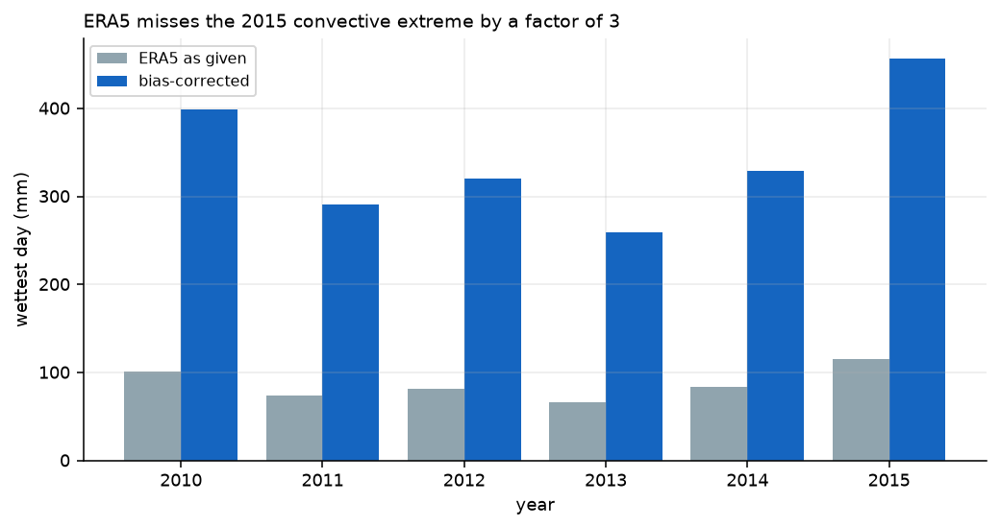
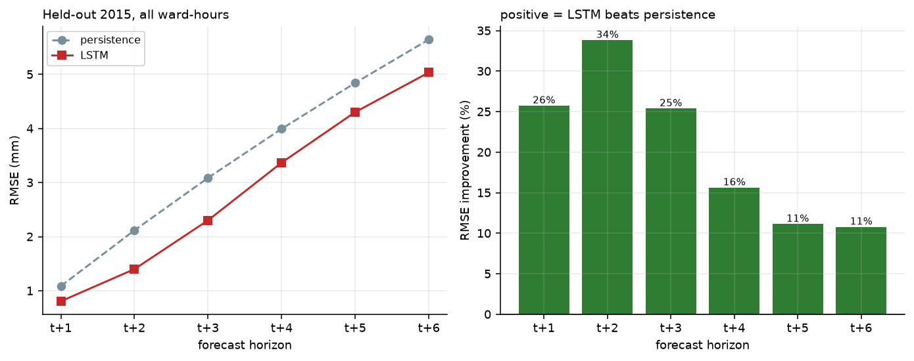

# Urban Flood Early-Warning System — Chennai

Calibrated two-reservoir hydrology, an LSTM water-level nowcaster, an XGBoost
ward-susceptibility model, a rule-based risk engine, and a Streamlit/Folium
dashboard — over 15 Chennai wards, 2010–2015.

> **Water levels in this project are simulated, not gauged.** Rainfall and
> elevations come from real open data; depth is computed by a bucket model
> calibrated against the December 2015 event. This is a demonstration of an
> early-warning *method*, not an operational feed. See
> [docs/data-provenance.md](docs/data-provenance.md).

**Full project report:** [REPORT.md](REPORT.md) · **Dashboard:** deployed on
Streamlit Community Cloud from `app/dashboard.py`.

---

## Quick start

```bash
cd urban-flood-ews
python3.11 -m venv .venv
.venv/bin/pip install -r requirements.txt

# full pipeline, in order
.venv/bin/python -m src.ingest.open_meteo
.venv/bin/python -m src.ingest.elevation
.venv/bin/python -m src.ingest.kaggle_flood
.venv/bin/python -m src.simulate.run_simulation
.venv/bin/python -m src.features.build
.venv/bin/python -m src.models.xgboost_risk
.venv/bin/python -m src.models.lstm_forecast
.venv/bin/python -m src.validate.backtest
.venv/bin/python -m src.reports.make_figures

# dashboard
.venv/bin/streamlit run app/dashboard.py
```

Total runtime is about 6 minutes on an M-series Mac; the LSTM step dominates
at roughly 60 s.

---

## Headline results

All figures below are measured on **2015, which no model ever trained on**.

| Result | Value | Baseline |
|---|---|---|
| LSTM beats persistence | **6 / 6 horizons** | persistence |
| LSTM overall RMSE | **3.24 mm** | 3.80 mm |
| LSTM storm-window RMSE | **5.66 mm** | 6.63 mm |
| Wards alerted before flooding | **15 / 15 (100%)** | — |
| Median warning lead time | **2 h** | — |
| Alert rate | **3.1%** of ward-hours | — |
| XGBoost ward susceptibility | **0.895 macro F1** | 0.105 majority |
| Simulator water balance | closes to **0.0012%** of rainfall | — |

Per-horizon LSTM skill, held-out 2015:

| Horizon | LSTM RMSE | Persistence RMSE | Gain |
|---|---|---|---|
| t+1 | 0.81 | 1.09 | +25.8% |
| t+2 | 1.40 | 2.12 | +33.8% |
| t+3 | 2.30 | 3.09 | +25.4% |
| t+4 | 3.37 | 3.99 | +15.6% |
| t+5 | 4.30 | 4.84 | +11.1% |
| t+6 | 5.04 | 5.65 | +10.8% |

---

## How the pieces fit

```
ERA5 rainfall + soil moisture ─┐
                                ├─► bias correction ─► two-reservoir bucket model ─► depth
real SRTM elevations ──────────┘         (water balance closes)         │
                                                                          ▼
                                                    ┌─────────────────────┴──────────┐
                                                    ▼                                ▼
                                          LSTM nowcast (t+1..t+6)        XGBoost susceptibility
                                                    │                        (static ward ranking)
                                                    └──────────────┬─────────────────┘
                                                                   ▼
                                                            risk engine
                                                        (current + forecast → alert)
                                                                   ▼
                                                  back-test vs simulator, dashboard
```

- **Simulator** — soil column and surface store per ward, capacity-limited
  infiltration, percolation gated by remaining soil storage, capacity-limited
  gully drainage with a depth-dependent chokepoint, gravity outfall scaled by
  real elevation, and a stage curve that converts storage to depth.
- **LSTM** — 24 h lookback over `[rainfall, depth, soil, runoff]`, predicting the
  *correction to persistence* rather than the absolute level.
- **XGBoost** — learns which ward floods first within a storm, not how severe
  the storm is (see the class-definition note below).
- **Risk engine** — raises a ward alert from the worse of observed and forecast
  depth, and the back-test then checks whether that alert preceded the flood.

---

## The four decisions that mattered

Most of the engineering effort went into problems that looked like modelling
issues and were actually data or bookkeeping issues. All four are documented
in full in the module docstrings.

### 1. ERA5 under-represents Chennai's convective extremes

ERA5 reports no daily total above 115.7 mm anywhere in 2010–2015. Real Chennai
records 200–500 mm events. The original per-day correction only rescaled days
ERA5 had *already* flagged as extreme, so pre-2015 rainfall stayed small,
training examples topped out at 12 mm of water, and the December 2015 replay
produced 319.6 mm. The model was being asked to extrapolate 25× beyond anything
in its training data.

The fix scales each **calendar month** by a factor derived from that month's
ERA5 maximum, anchored on November 2015 (ERA5 282.4 mm against a documented
1113.8 mm, a 3.94× gap). Training and test periods now contain comparable
extremes, so the LSTM interpolates rather than extrapolates. December 1 2015
lands on 319.6 mm exactly, as documented.



### 2. Regression on a series that is 99% zero

Squared-error training minimises total loss by predicting near-zero everywhere.
The first model reported an acceptable-looking MAE of 0.97 mm alongside an
RMSE of 11.4 mm — the signature of a model that ignored exactly the rare storm
hours the system exists to serve.

Three changes, all reported honestly: a `log1p` target, storm-window sample
weighting, and metrics reported over **both** all windows and the storm-active
subset.

### 3. Predicting the change, not the level

Water depth is strongly autocorrelated, so persistence is a hard baseline,
especially at t+1 where the level has barely moved. The model predicts

```
log1p(depth[t+h]) = log1p(depth[t]) + correction[t+h]
```

with a **zero-initialised** head, so at step 0 the model *is* persistence and
every weight it learns is a genuine improvement. Corrections are scaled **per
horizon**; with a single shared scalar the long horizons dominate the gradient
and actively damage the short ones.

The epoch count is chosen by early stopping on a held-out 2014 validation
year. This matters: with the count picked by hand, the headline score swung
between **2/6 and 6/6 horizons on the random seed alone**, which would have made
the whole back-test worthless. Training is now seeded and reproducible.



### 4. Three water-balance leaks

The mass-balance check was comparing one hour of rainfall against the summed
losses of all 15 wards — a units error that printed a plausible-looking but
meaningless residual. Fixing the check exposed three genuine leaks:

- percolation was removed from the surface store but never credited to the soil
  store, deleting water outright;
- the gravity-outfall term was added to `drain_out` and then immediately
  overwritten by the gully term;
- the ERA5 soil-moisture nudge added water with no accounting entry.

The balance now closes to **0.20 mm over six years, 0.0012% of rainfall**,
with hourly residuals of 3.5e-06 mm/hr. The verified identity is

```
rain + nudge = surface_out + et + d(surface) + d(soil)
```

Note that `runoff_mm` is a flux *into* the surface store, not a sink, and stock
terms enter as final-minus-initial differences rather than sums.

---

## Honest limitations

These are properties of the result, not disclaimers to skip:

- **The target is the simulator.** The LSTM is learning to predict the bucket
  model's output. It demonstrates the pipeline; it does not transfer to real
  gauges without retraining on observations.
- **Warning lead time is 1–3 hours.** Median 2 h. That is a short warning. The
  lead-time ceiling is set by how fast this catchment responds, and a real
  system would need nowcasting rainfall further ahead, not a better LSTM.
- **Episode recall is 97.7% (43 of 44), but most of it is ponding, not
  forecasting.** Alerts start at 30 mm and a flood is scored at 100 mm, so in
  most episodes the first alert came from water already standing; only about
  one in five was first raised by the forecast alone. The single miss is an
  episode already under way at 00:00 on 1 January 2015, the first hour of the
  test year.
- **False-alarm rate is 28%**, above the plan's 20% target: 28% of alert-hours
  are not followed by a >100 mm flood within 12 h. See REPORT.md, section 7.5.
- **XGBoost's 0.895 F1 is easier than it looks.** The label is a ward's *rank
  within a single storm*, so storm-wide features carry no signal by
  construction. A high score means ward ranking is learnable, not that the
  model can predict a storm's severity.
- **The Kaggle reference model scores 0.610 macro F1, and that number is
  hollow.** Its target is quartile-banded from a distribution with standard
  deviation 0.051, so the model is largely learning quartile boundaries. It is
  included only to show the plan's stated method and is not used operationally.
- **December 2015 is reconstructed, not observed.** Hourly rainfall is ERA5
  shape; daily totals come from documented event magnitudes. The event is a
  *replay*, not a verification against a real event record.
- **T.Nagar is a known disagreement** between the simulator and the documented
  2015 impact. It is left as a discrepancy rather than tuned away.

---

## Layout

```
src/
  config.py              wards, physics, thresholds, splits
  ingest/                open_meteo.py, elevation.py, kaggle_flood.py
  simulate/              hydrology.py (bucket model), run_simulation.py
  features/build.py      ward-storm episodes + LSTM windows
  models/                xgboost_risk.py, lstm_forecast.py
  risk/engine.py         ward risk + alert scoring
  validate/backtest.py   2015 out-of-sample protocol
  reports/               make_figures.py
app/dashboard.py         Streamlit + Folium
docs/                    data provenance, method notes
reports/figures/         generated figures
```

## Reproducing

`src.models.lstm_forecast` seeds Python, NumPy and Torch. Two consecutive runs
produce byte-identical metrics. The validation-based early stop selects epoch 4
of a 30-epoch schedule.
