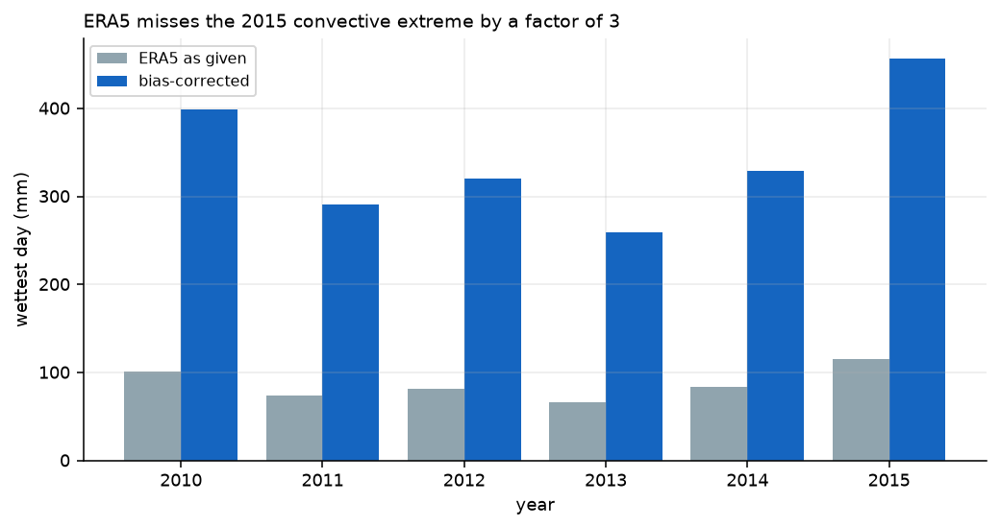
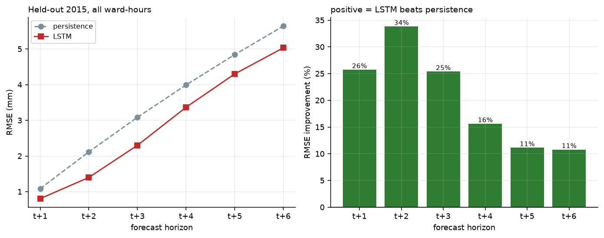
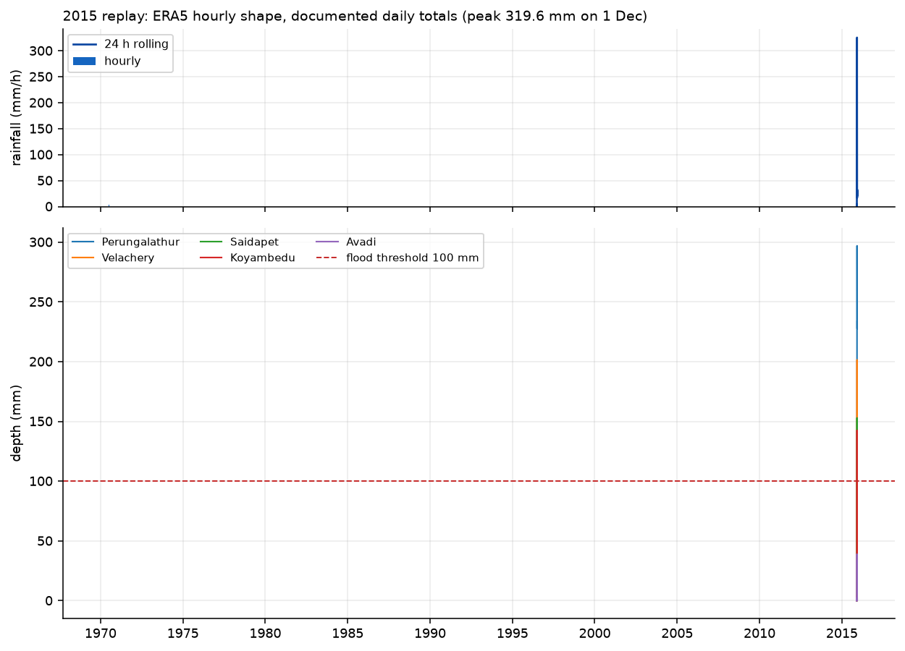

# Urban Flood Early-Warning System: Project Report

**Chennai, 15 wards · December 2015 replay**
Course: Project Management (21MGO112T), Dept. of Computing Technologies, SRMIST
Report date: 28 September 2026

> **Read this first.** Water levels in this project are **simulated**, not
> gauged. Rainfall and elevations are real open data, and a hydrology model
> calibrated against the December 2015 flood turns them into water depth.
> Every result below measures how well the system predicts and warns about
> that simulator. It demonstrates an early-warning *method*. It is not an
> operational flood feed.

---

## Contents

1. [Executive summary](#1-executive-summary)
2. [Problem and objectives](#2-problem-and-objectives)
3. [Scope: planned vs delivered](#3-scope-planned-vs-delivered)
4. [System architecture](#4-system-architecture)
5. [Data](#5-data)
6. [Methods](#6-methods)
7. [Results](#7-results)
8. [Engineering problems found and fixed](#8-engineering-problems-found-and-fixed)
9. [Dashboard and deployment](#9-dashboard-and-deployment)
10. [Limitations](#10-limitations)
11. [Project management review](#11-project-management-review)
12. [Future work](#12-future-work)
13. [Reproducing the results](#13-reproducing-the-results)
14. [Appendix: repository layout](#appendix-repository-layout)

---

## 1. Executive summary

City-wide flood bulletins come too late and cover too large an area for anyone
to act on them. This project built a working prototype that warns each of 15
Chennai wards separately, a few hours before water stands in its streets.

The system has five parts:

- a **two-reservoir hydrology simulator**, driven by real ERA5 rainfall and
  real SRTM elevations and calibrated on the December 2015 flood;
- an **LSTM nowcaster** that forecasts ward water depth 1 to 6 hours ahead;
- an **XGBoost susceptibility model** that ranks which wards flood first in a
  storm;
- a **rule-based risk engine** that turns current and forecast depth into one of
  four colour-coded alert levels;
- a **Streamlit dashboard** that replays the December 2015 flood hour by hour
  on a ward map.

All results are measured on **2015, a year no model trained on**.

| Result | Value | Baseline / target |
|---|---|---|
| LSTM beats "same as now" persistence | **6 / 6 horizons** | objective: beat persistence |
| LSTM pooled RMSE, all windows | **3.24 mm** | persistence 3.80 mm |
| LSTM pooled RMSE, storm windows | **5.66 mm** | persistence 6.63 mm |
| Wards warned before their first flood | **15 / 15 (100%)** | — |
| 2015 flood episodes warned in advance | **43 / 44 (97.7%)** | — |
| …of which first flagged by the forecast alone | **~1 in 5** | — |
| Median warning lead time | **2 h** (min 1 h) | plan target: 6 h |
| Alert rate | **3.1%** of ward-hours | — |
| False-alarm rate (alert-hours with no flood within 12 h) | **28.0%** | plan target: < 20% |
| XGBoost ward susceptibility, macro F1 | **0.895** | majority baseline 0.105 |
| Simulator water balance | closes to **0.0012%** of rainfall | — |
| Dec 2015 flood/no-flood agreement | **14 / 15 wards** | — |

**Verdict.** The forecasting and susceptibility objectives are met. The
warning objectives are only partly met. Almost every flood episode is warned,
but most warnings come from water already ponding rather than from the
forecast alone. Lead time (2 h against a 6 h target) and false alarms (28%
against a 20% target) both fall short. Sections 7.4–7.6 explain why, and
section 12 lists what would close the gap.

---

## 2. Problem and objectives

Existing warnings have four failings, as set out in the project charter:

1. **Too coarse.** IMD bulletins cover a whole district. A low-lying street
   gets the same alert as high ground, so people learn to ignore alerts.
2. **Too late.** Nowcasts confirm rain that has already fallen.
3. **Drainage is ignored.** Blocked drains and low ground decide where water
   stands, but neither is used in current warnings.
4. **Data is siloed.** Gauges, GIS and complaint records are never combined.

The project's aim in one line: **predict *where* and *when* water will stand,
not just whether it will rain.**

### Objective status

| ID | Objective | Measure of success | Status |
|---|---|---|---|
| O1 | Build the dataset | Real rainfall, simulated levels and ward features, clean files | ✅ Met: 788,760 ward-hours, zero nulls |
| O2 | Forecast water level 6 h ahead | LSTM RMSE below the persistence baseline | ✅ Met at all 6 horizons |
| O3 | Rate ward flood risk | Four-class XGBoost, F1 reported | ✅ Met: macro F1 0.895 |
| O4 | Show alerts | Dashboard map coloured by alert level | ✅ Met, and deployed online |
| O5 | Test on a past flood | Replay Dec 2015; report lead time and false-alarm rate | ⚠️ Done, but targets missed: 2 h lead, 28% false alarms |
| O6 | Manage the project formally | Charter, WBS, schedule, risk register, closure | ✅ Plan documents complete; closure in section 11 |

---

## 3. Scope: planned vs delivered

| Area | Plan | Delivered | Why it changed |
|---|---|---|---|
| Rainfall | Open-Meteo hourly | Open-Meteo ERA5 hourly **plus a documented bias correction** | ERA5 under-reports Chennai's extremes by up to 3.9× (section 5.1) |
| Water level | One-line formula: level + rain × runoff − drain capacity | **Two-reservoir bucket model** with soil storage, infiltration, gully drainage and gravity outfall | The simple formula flooded every ward the same way, which is not what happened in 2015 |
| Elevation | Simulated ward scores | **Real SRTM30m elevations** | Free, real, and the strongest single factor in who floods |
| XGBoost training data | Kaggle flood-factor dataset | **Ward-storm episodes from the simulator**; Kaggle kept as a reference only | The Kaggle target has a standard deviation of 0.051; its F1 is not meaningful (section 7.3) |
| Deep-learning framework | TensorFlow/Keras or PyTorch | PyTorch | Runs on Apple Silicon (MPS) without extra setup |
| Test event | Dec 2015 or Dec 2023 | Dec 2015 | Best-documented event, with daily totals to calibrate against |
| Deployment | **Out of scope** ("no cloud deployment") | Dashboard deployed on Streamlit Community Cloud | Needed for the class demo. It serves saved results only, so no scope was added to the models |

Nothing from the out-of-scope list (sensors, agency data, mobile app, SMS,
CNN) was built.

---

## 4. System architecture

```
ERA5 rainfall + soil moisture ─┐
                               ├─► bias correction ─► two-reservoir bucket model ─► depth
real SRTM elevations ──────────┘       (water balance closes to 0.0012%)            │
                                                                                     ▼
                                              ┌──────────────────────────────────────┤
                                              ▼                                      ▼
                                    LSTM nowcast (t+1..t+6)             XGBoost susceptibility
                                              │                          (static ward ranking)
                                              └──────────────┬───────────────────────┘
                                                             ▼
                                                        risk engine
                                             (worse of observed and forecast → alert)
                                                             ▼
                                         2015 back-test vs simulator · Streamlit dashboard
```

| Layer | Module | Output |
|---|---|---|
| Ingest | `src/ingest/open_meteo.py`, `elevation.py`, `kaggle_flood.py` | `data/raw/*` |
| Simulate | `src/simulate/hydrology.py`, `run_simulation.py` | `hourly_panel.parquet` (15 wards × 52,584 h) |
| Features | `src/features/build.py` | ward-storm episodes, LSTM windows |
| Models | `src/models/lstm_forecast.py`, `xgboost_risk.py` | `lstm_forecast.pt`, `xgb_susceptibility.json` |
| Decide | `src/risk/engine.py` | per-ward alert and severity |
| Validate | `src/validate/backtest.py` | `backtest_2015.json`, per-ward CSV |
| Present | `app/dashboard.py` | Streamlit + Folium dashboard |

---

## 5. Data

Every input is labelled **real**, **derived**, **assumed** or **simulated**.
Full detail is in [`docs/data-provenance.md`](docs/data-provenance.md).

| Input | Source | Status | Used for |
|---|---|---|---|
| Hourly rainfall and soil moisture, 2010–2015 | Open-Meteo ERA5 reanalysis, 13.08 N 80.27 E | real (shape) | model input |
| Rainfall magnitude on documented days | ICRIER / Corporation of Chennai totals | derived | 2015 replay |
| Monthly rainfall extremes | ERA5 rescaled per month | derived | realistic training storms |
| Ward elevation | OpenTopData SRTM30m | real | outfall physics, features |
| Imperviousness, drain quality | assigned per ward | assumed | physics, features |
| Water depth | bucket model | simulated | target and ground truth |
| Kaggle flood-factor data | Kaggle | real, narrow target | reference only |

### 5.1 The rainfall correction

ERA5 is a reanalysis on a grid of roughly 31 km. It smooths out convective
downpours, and the December 2015 storm was exactly that kind of event.

| Quantity | ERA5 | Documented | Ratio |
|---|---|---|---|
| Wettest day in 2010–2015 | 115.7 mm | 319.6 mm (1 Dec 2015) | 2.8× |
| November 2015 total | 282.4 mm | 1,113.8 mm | 3.9× |

The correction runs in two stages:

1. **Documented days** are rescaled hour by hour to match their documented
   daily total. 1 December 2015 lands on exactly 319.6 mm.
2. **Every other month** is scaled by a factor based on that month's ERA5
   maximum: `1 + (3.94 − 1) × min(month_max / 60, 1)`.

The same function builds both the training series and the replay, so the two
cannot drift apart.



### 5.2 Study wards

| Ward | Elev. (m) | Impervious | Drain quality | Dec 2015 (documented) |
|---|---|---|---|---|
| Perungalathur | −2 | 78% | 30% | flooded |
| Velachery | 6 | 72% | 35% | flooded |
| Madipakkam | 9 | 70% | 45% | flooded |
| Chetpet | 8 | 85% | 28% | flooded |
| Saidapet | 12 | 74% | 40% | flooded |
| Perungudi | 8 | 76% | 42% | flooded |
| Egmore | 8 | 80% | 38% | flooded |
| Triplicane | 10 | 82% | 33% | flooded |
| Mylapore | 14 | 75% | 48% | waterlogged |
| Purasawalkam | 14 | 81% | 50% | waterlogged |
| Koyambedu | 11 | 79% | 55% | waterlogged |
| Guindy | 12 | 83% | 52% | waterlogged |
| T.Nagar | 16 | 88% | 45% | minor |
| Ambattur | 23 | 62% | 62% | drained |
| Avadi | 29 | 55% | 68% | drained |

---

## 6. Methods

### 6.1 Hydrology simulator

Each ward has two stores that update every hour:

- **Soil column.** Infiltration is limited by capacity and collapses as the soil
  saturates. Evapotranspiration draws water out of it.
- **Surface store.** It receives runoff, loses water by percolation (limited by
  how much room is left in the soil), drains through gullies (capacity-limited,
  with a chokepoint that grows with depth) and flows out by gravity at a rate
  scaled by real elevation. Wards at or below −3 m have no gravity outfall.

A stage curve converts surface storage to depth. Alert thresholds are 30 mm
(Moderate), 80 mm (High) and 150 mm (Severe), and a ward counts as flooded
above 100 mm.

**Mass balance.** The verified identity per ward per hour is
`rain + nudge = surface_out + et + Δsurface + Δsoil`. The residual is
3.5 × 10⁻⁶ mm/h, or 0.20 mm over six years (0.0012% of the 16,560 mm that fell).

### 6.2 LSTM nowcaster

| Setting | Value |
|---|---|
| Input | 24 h lookback over `[rainfall, depth, soil, runoff]` |
| Output | depth at t+1 … t+6 h |
| Formulation | predicts the *correction* to persistence: `log1p(d[t+h]) = log1p(d[t]) + Δ[t+h]` |
| Head | zero-initialised, so an untrained model *is* persistence |
| Scaling | per-horizon correction standard deviation |
| Loss | squared error on the `log1p` target, storm windows weighted ×400 |
| Split | train 2010–2013, validate 2014 (early stopping), test 2015 |
| Size | 39,942 parameters, 657,015 training windows |
| Reproducibility | Python, NumPy and Torch seeded; two runs give byte-identical metrics |

### 6.3 XGBoost ward susceptibility

- **Unit:** one ward in one storm (ward-storm episode), 2,895 training and
  555 test episodes.
- **Label:** the ward's *rank within that storm* (Low / Moderate / High /
  Severe), taken from the simulator's hours above the flood level and its peak
  depth.
- **Features:** elevation, imperviousness, drain quality, drain capacity ratio,
  storm rainfall (hourly maximum, 6 h maximum, total, duration), rainfall in
  the previous 72 h and antecedent soil moisture.

### 6.4 Risk engine

For each ward at the current hour, the engine does four things:

1. It reads the **current** simulated depth. That is legitimate, because a real
   operator could read a gauge.
2. It takes the **LSTM forecast issued in that hour** and keeps its peak over
   t+1 to t+4 h.
3. It sets the trigger depth to the **worse** of the two and maps it to a
   severity level.
4. It raises an alert if either value reaches 30 mm.

The engine never reads the simulator's future. Section 8.5 describes a leak of
exactly this kind that was found and fixed.

| Level | Depth | Advice to residents |
|---|---|---|
| 🟢 Low | < 30 mm | No action. Normal monsoon conditions. |
| 🟡 Moderate | 30–80 mm | Water may pond in low-lying streets. Move vehicles. |
| 🟠 High | 80–150 mm | Waterlogging likely. Avoid low-lying roads. |
| 🔴 Severe | ≥ 150 mm | Flooding imminent or occurring. Move to higher ground now. |

---

## 7. Results

### 7.1 LSTM vs persistence (held-out 2015)

**All windows** (n = 131,310):

| Horizon | LSTM RMSE (mm) | Persistence RMSE (mm) | Gain |
|---|---|---|---|
| t+1 | 0.81 | 1.09 | +25.8% |
| t+2 | 1.40 | 2.12 | +33.8% |
| t+3 | 2.30 | 3.09 | +25.4% |
| t+4 | 3.37 | 3.99 | +15.6% |
| t+5 | 4.30 | 4.84 | +11.1% |
| t+6 | 5.04 | 5.65 | +10.8% |
| **Pooled** | **3.24** | **3.80** | |

**Storm-active windows only** (n = 43,108): any depth > 1 mm, any 24 h rain
> 2 mm, or any forecast > 1 mm. This subset is the fair basis for an
early-warning claim.

| Horizon | LSTM RMSE (mm) | Persistence RMSE (mm) | Gain |
|---|---|---|---|
| t+1 | 1.41 | 1.90 | +25.8% |
| t+2 | 2.45 | 3.70 | +33.8% |
| t+3 | 4.02 | 5.39 | +25.4% |
| t+4 | 5.88 | 6.97 | +15.6% |
| t+5 | 7.51 | 8.45 | +11.1% |
| t+6 | 8.79 | 9.85 | +10.8% |
| **Pooled** | **5.66** | **6.63** | |

The gain peaks at t+2 and shrinks with range. That is why the risk engine
trusts the forecast only out to t+4.



### 7.2 XGBoost ward susceptibility

| Class | Precision | Recall | F1 | Support |
|---|---|---|---|---|
| Low | 0.870 | 0.847 | 0.858 | 111 |
| Moderate | 0.886 | 0.892 | 0.889 | 148 |
| High | 0.895 | 0.919 | 0.907 | 148 |
| Severe | 0.932 | 0.919 | 0.925 | 148 |
| **Macro** | **0.896** | **0.894** | **0.895** | 555 |

Majority-class baseline: 0.105 macro F1.

Top features by importance: hourly rainfall maximum (0.187), elevation (0.172),
elevation index (0.165), imperviousness (0.156), drain quality (0.134).
Ward-level physical attributes dominate, which is expected for a model that
ranks wards *within* a storm.

**The Kaggle reference model scores 0.610 macro F1, and that number means
little.** Its target is split into quartiles of a distribution with standard
deviation 0.051, so the model mostly learns where the quartile boundaries fall.
It is reported only because the plan named this method.

### 7.3 December 2015 event replay

The replay reproduces the documented flood/no-flood outcome in **14 of 15
wards**:

| Ward | Elev. (m) | Peak depth (mm) | Hours above flood | Simulated class | Documented |
|---|---|---|---|---|---|
| Perungalathur | −2 | 296.9 | 115 | Severe | flooded |
| Velachery | 6 | 201.5 | 84 | Severe | flooded |
| Chetpet | 8 | 193.6 | 78 | Severe | flooded |
| Egmore | 8 | 180.8 | 71 | Severe | flooded |
| Perungudi | 8 | 175.9 | 67 | High | flooded |
| Triplicane | 10 | 172.7 | 64 | High | flooded |
| Madipakkam | 9 | 166.5 | 54 | High | flooded |
| Saidapet | 12 | 152.9 | 39 | High | flooded |
| Koyambedu | 11 | 142.5 | 34 | High | waterlogged |
| Guindy | 12 | 139.3 | 32 | High | waterlogged |
| Mylapore | 14 | 131.4 | 28 | High | waterlogged |
| Purasawalkam | 14 | 129.0 | 26 | High | waterlogged |
| T.Nagar | 16 | 123.0 | 23 | High | **minor** ← disagreement |
| Ambattur | 23 | 54.1 | 0 | Low | drained |
| Avadi | 29 | 39.0 | 0 | Low | drained |

Elevation separates the wards cleanly: the two inland wards above 20 m drain,
and the coastal and floodplain wards flood.



**The warning in action (from the dashboard).** At **1 Dec 2015, 01:00** all
15 wards go on alert. **12 of them are still dry at that moment**: they are
warned by the LSTM forecast alone, before any water arrives. By 02:00, 13
wards are above 30 mm, and by 03:00 all 15 are. This passes the plan's quality
check that "wards change colour before peak water level".

| Replay time | Wards on alert | Severity mix |
|---|---|---|
| 30 Nov 18:00 (calm before) | 1 | 1 Severe (Perungalathur, standing water from November) |
| 1 Dec 01:00 (forecast warning) | 15 | 12 warned while still dry |
| 1 Dec 12:00 (peak rain) | 15 | 12 High, 2 Moderate, 1 Severe |
| 2 Dec 12:00 (worst flooding) | 14 | 8 Severe, 5 High, 1 Moderate |
| 4 Dec 12:00 (draining) | 8 | 5 High, 2 Moderate, 1 Severe |
| 7 Dec 00:00 (receded) | 1 | Perungalathur only |

### 7.4 2015 back-test

**Protocol.** The LSTM was trained on 2010–2014 and never refitted. For every
3 hours of 2015, the engine saw only the current state and the forecast issued
in that hour. The simulator was then used once, as ground truth, to score the
alerts. An alert counts only if it fires within the 12 hours **before** a
flood episode begins.

| Metric | Value |
|---|---|
| Flood episodes in 2015 (depth > 100 mm) | 44 |
| Episodes warned in advance | 43 (97.7%) |
| Wards warned before at least one flood | 15 / 15 (100%) |
| Median lead time | 2 h |
| Minimum lead time | 1 h |
| Alert records | 1,377 of 43,800 ward-hours (3.1%) |
| Severity mix of alerts | Severe 39%, High 36%, Moderate 25% |

Per ward:

| Ward | Episodes | Warned | Missed | Median lead (h) | Peak depth (mm) |
|---|---|---|---|---|---|
| Perungalathur | 2 | 1 | 1 | 2.0 | 576 |
| Velachery | 3 | 3 | 0 | 1.0 | 274 |
| Chetpet | 3 | 3 | 0 | 2.0 | 270 |
| Egmore | 4 | 4 | 0 | 2.0 | 261 |
| Perungudi | 4 | 4 | 0 | 2.0 | 258 |
| Triplicane | 4 | 4 | 0 | 2.0 | 256 |
| Madipakkam | 3 | 3 | 0 | 3.0 | 250 |
| Saidapet | 3 | 3 | 0 | 3.0 | 239 |
| Koyambedu | 3 | 3 | 0 | 1.0 | 229 |
| Guindy | 3 | 3 | 0 | 1.0 | 227 |
| Mylapore | 3 | 3 | 0 | 1.0 | 221 |
| Purasawalkam | 3 | 3 | 0 | 1.0 | 219 |
| T.Nagar | 3 | 3 | 0 | 1.0 | 214 |
| Ambattur | 2 | 2 | 0 | 2.5 | 159 |
| Avadi | 1 | 1 | 0 | 3.0 | 134 |

**The single miss** is Perungalathur's episode that is already under way at
00:00 on 1 January 2015, the first hour of the test year. No alert could
precede it, so in practice every episode that *could* be warned was warned.

**Why recall is so high, and what it does and does not show.** Alerts start
at 30 mm (Moderate) and a flood is scored at 100 mm, so a ward usually passes
through the alert band on its way to flooding. For about **4 in 5** detected
episodes, the first alert in the 12 hours before onset came from water already
standing at ≥ 30 mm. Only about **1 in 5** (9 of 42 in a re-count) were first
raised by the LSTM forecast while the ward was still below 30 mm. The high
recall therefore shows that the alert ladder works. It does not show that the
forecast alone sees floods coming hours ahead.

**Lead time is scored conservatively,** from the *latest* alert before onset.
Measured from the *first* alert in the 12-hour window instead, the median would
be 10 h. That number is not claimed, because most of that time is the ponding
stage described above.

### 7.5 False-alarm rate

The plan asked for a false-alarm rate below 20%, but the original pipeline
never measured it. For this report it was computed from the saved 2015 alerts:

> **False alarm** = an alert-hour after which the ward does **not** exceed
> 100 mm at any point in the next *N* hours.

| Window N | Alerts followed by a flood | False-alarm rate |
|---|---|---|
| 6 h | 67.2% | 32.8% |
| 12 h | 72.0% | **28.0%** |
| 12 h, excluding Perungalathur | 65.1% | 34.9% |

**The < 20% target is not met.** Most of the gap comes from a definition
mismatch that was built in: alerts start at **30 mm** (Moderate, "water may
pond, move vehicles"), while a "flood" is scored at **100 mm**. A Moderate
alert for ponding that never becomes a flood counts as "false" here, even when
the advice was correct. Two fixes are possible. One is to score each severity
level against its own depth. The other is to raise the alert threshold to High
(80 mm), which would cut false alarms but also cut lead time. This trade-off
should be tuned against real impact data, not against the simulator.

### 7.6 Lead time

The median lead time of **2 h misses the 6 h target**. The limit is physical,
not a modelling one. The wards respond to rain within one to three hours, so
a depth forecast cannot see further ahead than the rain that drives it.
Longer warnings need a *rainfall* nowcast (radar extrapolation or NWP) feeding
the LSTM. A better LSTM would not help.

---

## 8. Engineering problems found and fixed

Most of the effort went into problems that looked like modelling issues but
turned out to be data or bookkeeping issues.

### 8.1 ERA5 under-represents Chennai's extremes

The first correction only rescaled days that ERA5 had already flagged as
extreme. Before 2015 there were none, so training storms topped out at 12 mm of
water while the replay reached 287 mm. The LSTM would have had to extrapolate
25× beyond anything it had seen. Switching to per-month scaling gives every
year realistic extremes (138–350 mm peak depth), so the model interpolates
instead.

### 8.2 A regression target that is mostly zero

Under squared error the best prediction is near zero almost everywhere. The
first model showed the telltale pattern: **MAE 0.97 mm but RMSE 11.4 mm**. It
ignored exactly the storm hours the system exists to serve. The fix was a
`log1p` target, ×400 weighting on storm windows, and reporting metrics on both
all windows and storm windows.

### 8.3 Predicting the change, not the level

Persistence is a hard baseline. The fix was a residual formulation with a
zero-initialised head, plus per-horizon scaling of the correction. Per-horizon
scaling alone moved the t+1 result from **−183% to +25.8%**. Choosing the
epoch count by early stopping on 2014 removed a seed lottery: before that, the
headline result swung between **2/6 and 6/6 horizons depending only on the
random seed**.

### 8.4 Three water-balance leaks

The mass-balance check compared one hour of rain against the losses of all 15
wards, a units error that printed a meaningless residual. Once the check was
fixed, it exposed three real leaks:

- percolation was removed from the surface store but never added to the soil
  store;
- the gravity-outfall term was overwritten by the gully term;
- the soil-moisture nudge added water with no accounting entry.

The balance now closes to 0.0012%.

### 8.5 A look-ahead leak in the risk engine (found during final review)

The forecast table stores each forecast under its **issue time**. The risk
engine was selecting forecasts with timestamps in `(now, now + 4 h]`. In other
words, it used forecasts that would be issued in the next four hours, built
from depths the operator had not yet seen. The engine now uses only the
forecast issued at the current hour, for horizons up to t+4.

After re-scoring, the headline numbers were **unchanged** (43 episodes
detected under the scoring used at the time; see 8.6,
100% ward recall, 2 h median lead), and the alert rate fell from 3.3% to 3.1%.
The fix matters because it makes the back-test valid.

### 8.6 Back-test scored against six years instead of one (found while writing this report)

`score_alerts` was given the full 2010–2015 panel, but alerts exist only for
2015. Every 2010–2014 flood episode (59 of the 103 counted) was scored as
"missed" automatically. The back-test reported **41.7%** episode recall. On
2015 only, the correct figure is **43 of 44 (97.7%)**. Ward recall, lead time
and alert rate did not change. `src/validate/backtest.py` now scores the test
year only.

### 8.7 Dashboard metric bugs

- The XGBoost baseline was read from the wrong JSON key and always showed
  0.000. It now shows 0.105.
- The "overall RMSE" was showing the t+1 value (0.81 mm). It now shows the
  pooled value (3.24 mm).

---

## 9. Dashboard and deployment

**Live app:** deployed on Streamlit Community Cloud from this repository
(entry point `app/dashboard.py`). See the repository README for the URL.

The dashboard reads only saved results, so it starts in seconds and never
re-runs the simulation or the models. On the cloud it installs a small set of
dependencies (`app/requirements.txt`: Streamlit, pandas, NumPy, PyArrow,
Folium, Plotly). It does **not** install PyTorch or XGBoost.

| Tab | What it shows |
|---|---|
| **Situation** | Replay clock and one-click storm stages, a status banner coloured by the worst alert, KPI cards, a rainfall timeline with a "now" marker, a ward map (halo = active warning), a ward table with 3 h trend and ⏱ for forecast-only warnings, and the advice card for each level |
| **Ward detail** | Rainfall and depth for a chosen ward; the LSTM forecast issued at the replay hour (red); the simulator's actual future (dotted, never shown to the engine); threshold bands; ward attributes and its back-test record |
| **Validation** | Back-test KPIs, LSTM vs persistence per horizon, episodes warned or missed per ward, XGBoost F1 and feature importance |
| **About & limits** | Architecture, limitations and the method figures |

A banner that cannot be dismissed states that all depths are simulated.

**Suggested demo script (about 3 minutes):**

1. **Calm before**: one ward (Perungalathur) is already under water from
   November rain. Everything else is green.
2. **Forecast warning**: the whole map lights up. Point to the banner, where
   12 wards are warned *while still dry*.
3. **Ward detail → Velachery**: the red forecast line rises ahead of the solid
   observed line.
4. **Worst flooding**: 8 wards are Severe, and Ambattur and Avadi on high
   ground stay green.
5. **Validation tab**: 6/6 horizons won and 43/44 episodes warned. Be clear
   that most of those warnings come from the ponding stage.

---

## 10. Limitations

- **The target is the simulator.** The LSTM predicts the bucket model's output.
  It would need retraining on real gauge data before any operational use.
- **Short lead time.** The median is 2 h, set by how fast the catchment
  responds (section 7.6).
- **Most warnings come from ponding, not the forecast.** Episode recall is
  97.7%, but only about 1 in 5 episodes was first flagged by the forecast
  while the ward was still dry (section 7.4).
- **False alarms are 28%,** above the 20% target, partly because of the
  30 mm / 100 mm definition mismatch (section 7.5).
- **Some inputs are assumed.** Imperviousness and drain quality are assigned
  values, and they rank among XGBoost's top features.
- **XGBoost's F1 is easier than it looks.** The label is a ward's rank within
  a storm, so the score reflects ranking skill. It is not a prediction of how
  severe a storm will be.
- **December 2015 is reconstructed.** The hourly shape comes from ERA5 and the
  daily totals from documented magnitudes. It is a replay, not a verification.
- **T.Nagar is a known disagreement** with the documented impact. It is left
  visible rather than tuned away.
- **15 wards, one rainfall grid point.** Chennai has 200 wards, and rainfall
  varies across the city more than one ERA5 cell can capture.

---

## 11. Project management review

### 11.1 Risk register outcome

| ID | Risk | What happened | Outcome |
|---|---|---|---|
| R1 | Simulated water levels look unrealistic | Occurred: the simple formula flooded every ward the same way | **Mitigated.** Two-reservoir model, real elevations, calibration to 14/15 wards |
| R2 | LSTM does not beat the naive baseline | Occurred early (t+1 at −183%, seed-dependent 2/6 to 6/6) | **Mitigated.** Residual formulation, per-horizon scaling, early stopping; now 6/6 |
| R3 | Too many false alarms | Occurred: 28% vs a 20% target | **Open.** Definition mismatch identified; threshold tuning needs real impact data |
| R4 | Schedule slips | Integration and debugging took most of the time | Absorbed by the planned buffer |
| R5 | Scope creep | Deployment added for the demo | **Controlled.** Serves saved results only; no model scope added |
| R6 | Colab GPU limits | Did not occur | Training runs in about 60 s locally (Apple MPS) |

**A new risk not in the register: evaluation errors.** Three times, the
evaluation itself was wrong: the water-balance units error, the forecast
look-ahead (which flattered the system), and the six-year scoring window
(which understated it by more than half). None would show up as a failing
test. All three produced plausible numbers.
Future projects should list "the metric is measuring the wrong thing" as a
risk, with an independent review of the evaluation code as the response.

### 11.2 Quality checks (plan section 11)

| Deliverable | Quality check | Result |
|---|---|---|
| Dataset | No missing hours; every ward has features and a water-level series | ✅ 52,584 h × 15 wards, zero nulls |
| LSTM | RMSE below the persistence baseline | ✅ 6/6 horizons, all and storm windows |
| XGBoost | F1 reported on a held-out split | ✅ 0.895 macro F1 on 2015 episodes |
| Dashboard | Replayed flood shows wards changing colour before peak water | ✅ 12 wards alerted while dry at 1 Dec 01:00 |
| Documents | Read by another team member | Plan v1 → v2 revised; this report for review |

### 11.3 Lessons learned

1. **Check the data before tuning the model.** Three of the four biggest
   problems looked like model failures and were really data or accounting
   errors.
2. **Check every metric, the good ones and the bad ones.** MAE 0.97 mm hid a
   useless model, and the Kaggle 0.61 F1 is hollow. An episode recall of 42%
   looked like an honest weakness and was really a scoring bug. The corrected
   98% needed its own caveat (mostly ponding). Report the context, not just
   the number.
3. **Fix the random seed and the stopping rule before comparing results.** A
   headline that changes with the seed is not a result.
4. **Write the target down, then measure it.** The false-alarm target was in
   the charter but was never computed until the closure report.
5. **Keep simulation honest in the interface.** A banner that cannot be
   dismissed stops a demo from being mistaken for a live feed.

### 11.4 Closure checklist

- [x] Working prototype: data, models, dashboard
- [x] Test report: lead time, false-alarm rate, RMSE, F1 (this document)
- [x] Ward risk map (dashboard Situation tab)
- [x] Code, processed data and README pushed to GitHub
- [x] Dashboard deployed online
- [ ] Final demo to the guide
- [ ] Guide sign-off

---

## 12. Future work

In rough order of impact:

1. **Rainfall nowcasting** (radar extrapolation or IMD/NWP forecasts) fed into
   the LSTM. This is the only route to the 6 h lead-time target.
2. **Retrain on real observations.** GCC water-level sensors or crowd-sourced
   waterlogging reports would replace the simulator as ground truth.
3. **Per-level scoring and threshold tuning** to bring false alarms under 20%.
4. **Surveyed ward attributes** (land cover from Sentinel-2, drain maps from
   GCC) to replace the assumed imperviousness and drain quality.
5. **Scale up** from 15 wards to all 200, with rainfall at finer resolution.
6. **Alert delivery** (SMS or WhatsApp) and comprehension trials with
   residents. This was out of scope for the course.

---

## 13. Reproducing the results

```bash
cd urban-flood-ews
python3.11 -m venv .venv
.venv/bin/pip install -r requirements.txt

.venv/bin/python -m src.ingest.open_meteo
.venv/bin/python -m src.ingest.elevation
.venv/bin/python -m src.ingest.kaggle_flood        # needs Kaggle data, not in repo
.venv/bin/python -m src.simulate.run_simulation
.venv/bin/python -m src.features.build
.venv/bin/python -m src.models.xgboost_risk
.venv/bin/python -m src.models.lstm_forecast
.venv/bin/python -m src.validate.backtest
.venv/bin/python -m src.reports.make_figures

.venv/bin/streamlit run app/dashboard.py
```

The full pipeline takes about 6 minutes on an M-series Mac. The LSTM is
seeded, and two runs produce byte-identical metrics.

---

## Appendix: repository layout

```
urban-flood-ews/
  app/
    dashboard.py            Streamlit + Folium dashboard
    requirements.txt        slim dependencies for Streamlit Cloud
  src/
    config.py               wards, physics, thresholds, splits
    ingest/                 Open-Meteo, SRTM elevation, Kaggle
    simulate/               bucket model + simulation runner
    features/build.py       ward-storm episodes, LSTM windows
    models/                 LSTM nowcaster, XGBoost susceptibility
    risk/engine.py          ward risk and alert scoring
    validate/backtest.py    2015 out-of-sample protocol
    reports/make_figures.py figures
  data/
    raw/                    rainfall, elevations (Kaggle excluded)
    processed/              hourly panel, forecasts, alerts, episodes
    models/                 trained models + metric JSONs
  docs/
    data-provenance.md      source and status of every input
    method-notes.md         why each modelling choice was made
  reports/
    figures/                generated figures
    backtest_2015_per_ward.csv
  README.md
  REPORT.md                 this document
```
